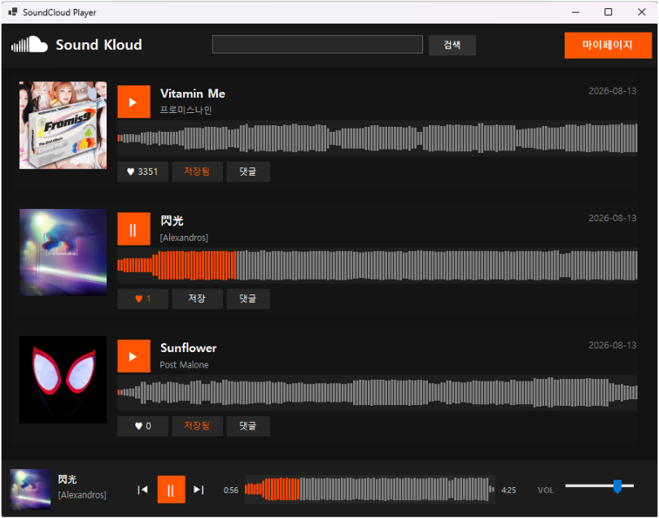
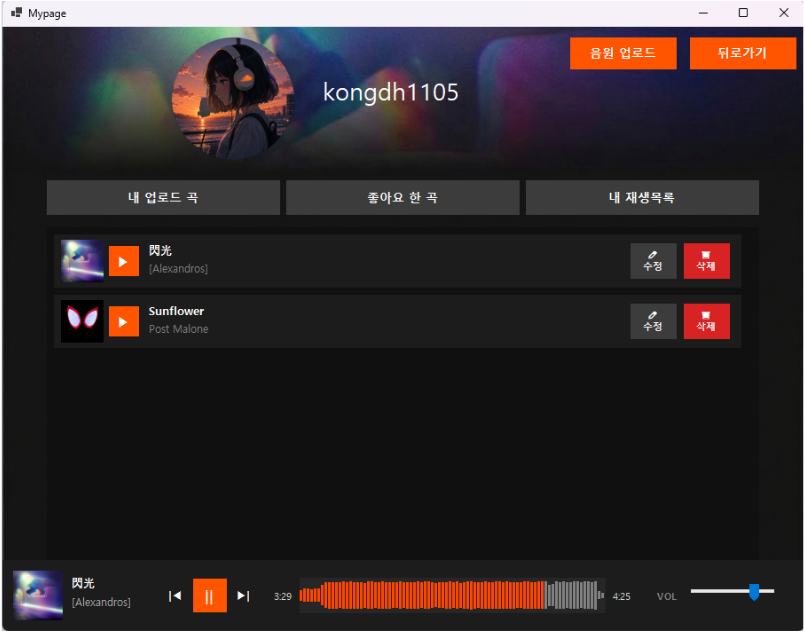
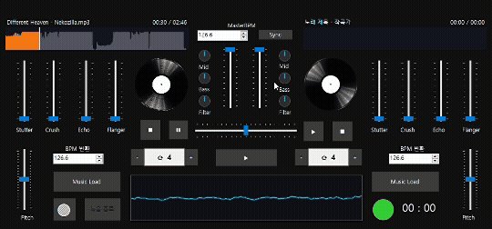

# 🎧 DJing

**SoundCloud 스타일 DJ 믹스 공유 플랫폼 & 미디어 플레이어**

 

## 📌 소개
음악을 업로드·공유하고 좋아요·댓글로 소통하는 **Sound Kloud** 모드와,
두 개의 덱으로 직접 믹싱하는 **DJ 모드**를 하나의 데스크톱 앱으로 구현했습니다.

## ✨ 주요 기능
| 영역 | 기능 |
|---|---|
| 👤 회원 | 회원가입 · 로그인 · 계정 찾기 · 프로필 아이콘/비밀번호 수정 |
| ☁️ Sound Kloud | 곡 업로드, 파형 표시 재생, 좋아요, 댓글, 검색 |
| 📁 마이페이지 | 내 업로드 곡 · 좋아요 한 곡 · 재생목록 관리 |
| 🎛 DJ 모드 | 턴테이블 2덱, 실시간 파형, 3밴드 EQ, 필터, 속도·피치, 글리치/스터터 이펙트, BPM 자동 검출 |

 DJ 모드 — 2덱 믹싱 화면

## 🙋‍♀️ 내 역할 — DB 설계 · SQL 전담
- 회원 / 곡 / 좋아요 / 댓글 / 재생목록 **DB 스키마 설계**
- 앱에서 쓰는 **SQL 쿼리 전체 작성**
- 사용자별 다중 곡 업로드를 막던 **UNIQUE 제약 버그 디버깅**
- **좋아요 토글** 로직, **상관 서브쿼리** 기반 댓글 로딩 구현
- 팀원의 로그인·회원가입 프로젝트와 백엔드 코드 **통합**
- Git 브랜치 협업 및 `.gitignore` 설정

> 팀 원본 저장소: [dragon1894-lab/moble2](https://github.com/dragon1894-lab/moble2)

## 🛠 기술 스택
`C#` `.NET 6 WinForms` `MySQL (MySql.Data)` `NAudio` `SoundTouch.Net`

## ▶️ 실행 방법
1. Visual Studio 2022에서 `DJing.sln` 열기 → NuGet 패키지 복원
2. MySQL에 `djing` 스키마 생성 후 테이블 생성
3. DB 접속 정보는 소스의 연결 문자열 기준 `localhost / root / 1111` → 본인 환경에 맞게 수정
4. resx 파일이 차단돼 있으면 파일 속성에서 **차단 해제**
5. `F5` 실행 (`TurnTable.png`는 빌드 시 자동 복사)
