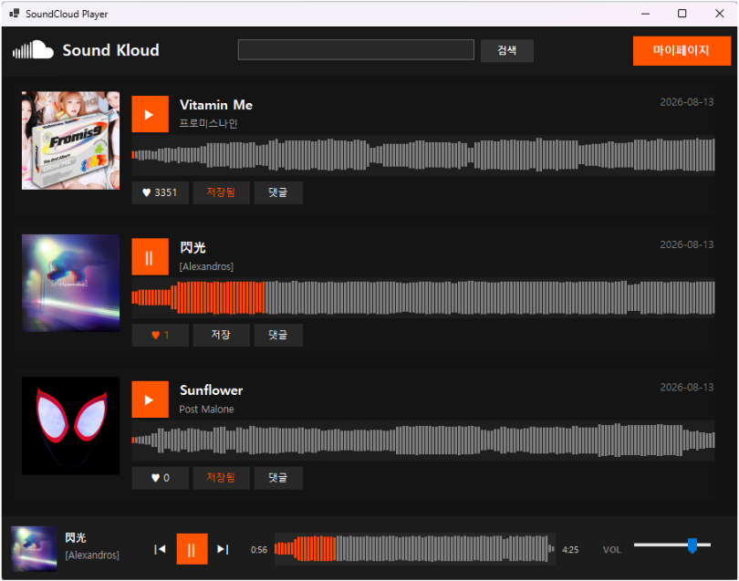
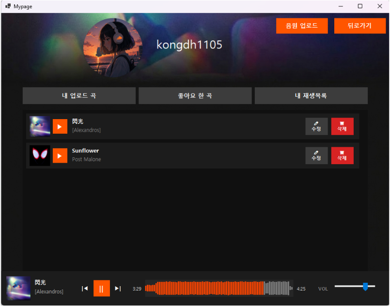
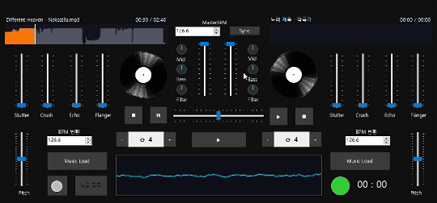
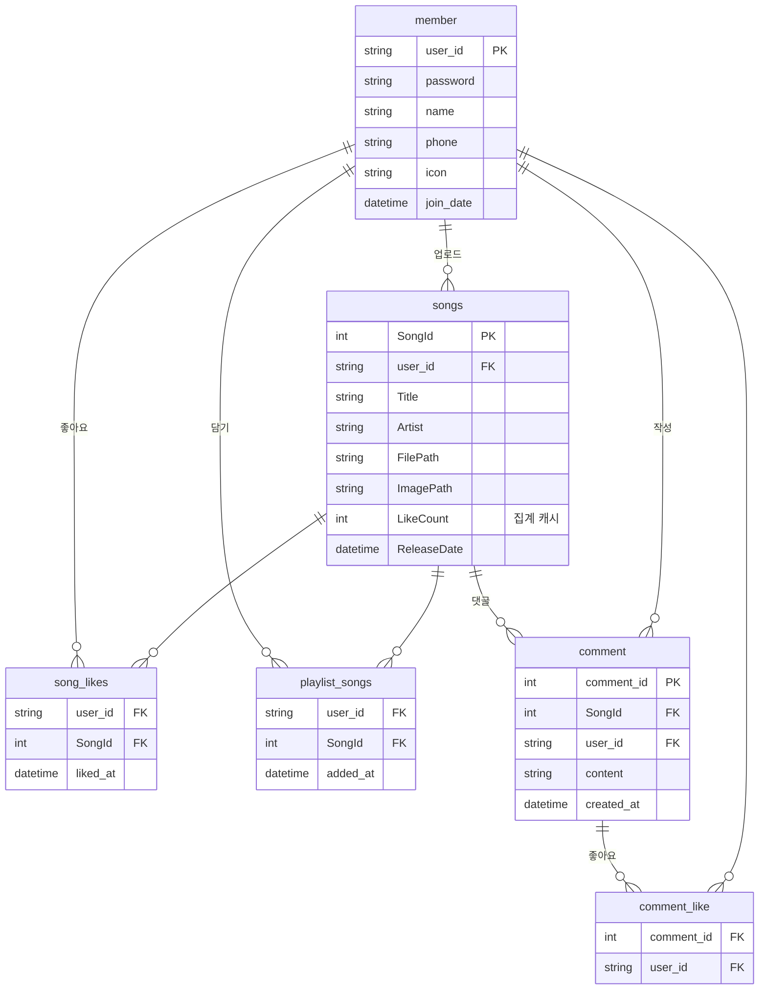

<div align="center">


**SoundCloud 스타일 음악 공유 플랫폼 + 2덱 DJ 믹서를 하나로 만든 데스크톱 앱**


<br>

 

</div>

<br>

## 📌 한눈에 보기

| | |
|---|---|
| **무엇을** | 곡 업로드 · 좋아요 · 댓글로 소통하는 **Sound Kloud 모드** + 두 덱으로 직접 믹싱하는 **DJ 모드** |
| **내 역할** | **DB 스키마 설계 · 앱 전체 SQL 작성 · 백엔드 통합** |
| **DB** | MySQL — 회원 · 곡 · 곡 좋아요 · 재생목록 · 댓글 · 댓글 좋아요 6개 테이블 |
| **포인트** | 좋아요 집계 전략 2가지 비교 · 상관 서브쿼리 + `EXISTS` · 파라미터 바인딩 · UNIQUE 제약 버그 해결 |

<br>

## ✨ 주요 기능

| 영역 | 기능 |
|---|---|
| 👤 회원 | 회원가입(아이디 중복 확인) · 로그인 · 아이디 찾기 / 비밀번호 재설정 · 프로필 아이콘 변경 |
| ☁️ Sound Kloud | 곡 업로드 · 수정, 파형 표시 재생, 좋아요, 댓글 · 댓글 좋아요, 검색 |
| 📁 마이페이지 | 내 업로드 곡 · 좋아요 한 곡 · 재생목록 관리 및 삭제 |
| 🎛 DJ 모드 | 턴테이블 2덱 · 실시간 파형 · 3밴드 EQ · 필터 · 속도/피치 · 글리치/스터터 · BPM 자동 검출 |

<div align="center">

<br><sub>DJ 모드 — 2덱 믹싱 화면</sub>
</div>

<br>

## 🙋‍♀️ 내 역할 — DB 설계 · SQL 전담

### 🗂 ERD



> 다대다 관계(회원 ↔ 곡의 좋아요 · 재생목록, 회원 ↔ 댓글의 좋아요)는 **연결 테이블**로 분리하고,
> 연결 테이블에 `liked_at` · `added_at`을 둬서 마이페이지를 "최근에 담은 순"으로 정렬할 수 있게 했습니다.

<br>

### 🔧 핵심 쿼리

<details open>
<summary><b>1. 댓글 목록 — 좋아요 수와 '내가 눌렀는지'를 한 번에</b></summary>
<br>

댓글마다 좋아요 수를 따로 조회하면 댓글 수만큼 쿼리가 나갑니다(N+1).
**상관 서브쿼리**로 개수를, **`EXISTS`** 로 현재 사용자의 좋아요 여부를 같은 쿼리에서 계산했습니다.

```sql
SELECT c.comment_id, c.user_id, c.content, c.created_at, m.icon,
       (SELECT COUNT(*) FROM comment_like cl
         WHERE cl.comment_id = c.comment_id)            AS like_count,
       EXISTS (SELECT 1 FROM comment_like cl2
                WHERE cl2.comment_id = c.comment_id
                  AND cl2.user_id   = @currentUserId)   AS is_liked
FROM comment c
INNER JOIN member m ON c.user_id = m.user_id
WHERE c.SongId = @songId
ORDER BY c.created_at DESC;
```
</details>

<details>
<summary><b>2. 좋아요 집계 — 두 가지 전략을 용도에 맞게</b></summary>
<br>

| | 곡 좋아요 | 댓글 좋아요 |
|---|---|---|
| 방식 | `songs.LikeCount` **카운터 캐시** + `song_likes` 기록 | `comment_like` 행을 **조회 시 COUNT** |
| 이유 | 곡 목록은 화면마다 반복 조회 → 매번 집계하지 않고 컬럼에서 바로 읽음 | 댓글은 곡 하나 단위로만 조회 → 정확성이 우선 |

카운터를 줄일 때는 음수가 되지 않도록 방어했습니다.

```sql
UPDATE songs SET LikeCount = GREATEST(LikeCount - 1, 0) WHERE SongId = @songId;
```
</details>

<details>
<summary><b>3. 좋아요 토글</b></summary>
<br>

이미 눌렀는지 먼저 확인한 뒤 `DELETE` / `INSERT`로 분기해, 같은 버튼이 누르기·취소를 모두 처리합니다.

```sql
SELECT COUNT(*) FROM comment_like WHERE comment_id = @commentId AND user_id = @userId;
-- > 0  →  DELETE FROM comment_like WHERE comment_id = @commentId AND user_id = @userId;
-- = 0  →  INSERT INTO comment_like (comment_id, user_id) VALUES (@commentId, @userId);
```
</details>

<details>
<summary><b>4. 마이페이지 — 연결 테이블 JOIN</b></summary>
<br>

```sql
SELECT songs.*
FROM songs
INNER JOIN song_likes ON songs.SongId = song_likes.SongId
WHERE song_likes.user_id = @userId
ORDER BY song_likes.liked_at DESC;
```
재생목록도 같은 구조로 `playlist_songs`와 JOIN, `added_at` 기준 정렬.
</details>

<br>

### 🧯 트러블슈팅

| 문제 | 원인 | 해결 |
|---|---|---|
| 한 사용자가 **두 번째 곡을 업로드하면 실패** | 사용자 기준으로 걸린 **UNIQUE 제약**이 사용자당 곡을 1개로 제한 | 제약 조건을 추적해 수정 → 사용자별 다중 업로드 가능 |
| 팀원이 따로 만든 로그인 · 회원가입 프로젝트 | 별도 프로젝트로 개발돼 백엔드와 분리된 상태 | 하나의 솔루션으로 **통합**하고 `member` 테이블 기준으로 쿼리 연결 |
| 사용자 입력이 SQL에 직접 들어갈 위험 | 문자열 연결로 쿼리를 만들면 인젝션 위험 | 모든 쿼리를 `@파라미터` 바인딩(`AddWithValue`)으로 작성 |

<br>

### 그 외
- 회원가입 시 **아이디 중복 확인**, 아이디 찾기 · 비밀번호 재설정 쿼리 (`UPDATE` 결과 행 수로 성공 여부 판단)
- 곡 업로드 / 수정 모드 분기 (`INSERT` ↔ `UPDATE`)
- Git 브랜치 협업 및 `.gitignore` 설정

> 팀 원본 저장소: [dragon1894-lab/moble2](https://github.com/dragon1894-lab/moble2)

<br>

## 🛠 기술 스택

| 구분 | 사용 |
|---|---|
| Language / UI | C# · .NET 6 WinForms |
| Database | MySQL · MySql.Data |
| Audio | NAudio (믹싱 · EQ · 파형) · SoundTouch.Net (BPM · 템포/피치) |
| Collaboration | Git · GitHub |

<br>

## ▶️ 실행 방법

1. Visual Studio 2022에서 `DJing.sln` 열기 → NuGet 패키지 복원
2. MySQL에 `djing` 스키마 생성 후 테이블 생성
3. DB 접속 정보는 소스의 연결 문자열 기준 `localhost / root / 1111` → 본인 환경에 맞게 수정
4. resx 파일이 차단돼 있으면 파일 속성에서 **차단 해제**
5. `F5` 실행 (`TurnTable.png`는 빌드 시 자동 복사)


